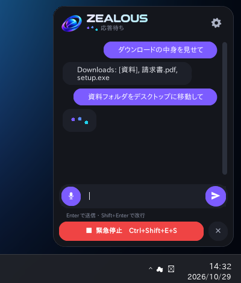

# Zealous（ゼラス）

デスクトップの右下に常駐し、話しかけるだけでPCを操作できるAIアシスタントです。
AIはすべてPCの中で動きます（会話の内容を外部のAIサービスに送りません）。

| 待機中 | 会話パネル |
|---|---|
|  |  |

## ダウンロード
[**最新版の ZealousSetup.exe**](../../releases/latest)（Windows 11）

## インストール
1. `ZealousSetup.exe` を実行
   - 「WindowsによってPCが保護されました」と出た場合は「詳細情報」→「実行」
2. 初回の準備画面で「準備を開始」を押す（AI・音声の部品 約1.5GB を自動でダウンロード）
3. 以後はデスクトップの **Zealous** から起動

## できること
- 「〇〇を調べて」… Webを検索して要約（出典・関連画像つき）
- 「〇〇の写真を探して」… 画像一覧を表示
- 「Excelを起動して」… アプリを起動
- 「デスクトップにメモを作って」「音量を30にして」… ファイル操作・PC操作

話しかけ方: **右Ctrl を押しながら話す** ／ マイクボタン ／ 「ウェイク、Zealous、〜」（設定でON）

## アップデート・アンインストール
- 新しい版が出ると Zealous が知らせ、ボタン1つで更新できます
- アンインストールは Windows の「設定 > アプリ」から
